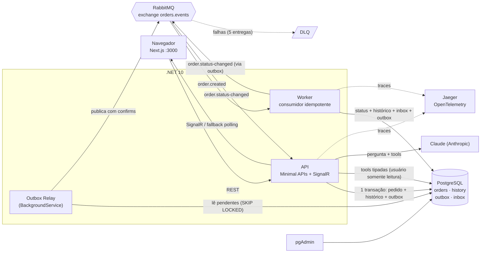
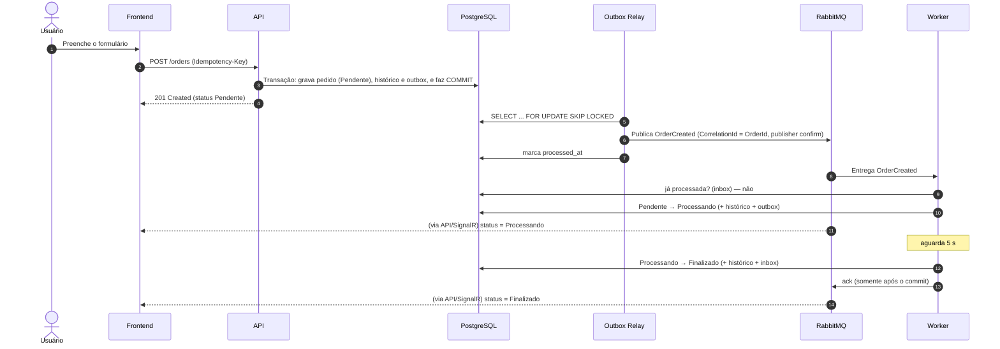
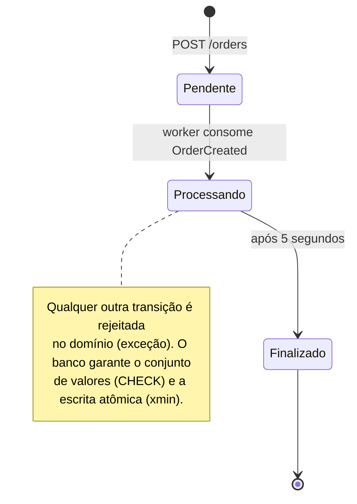
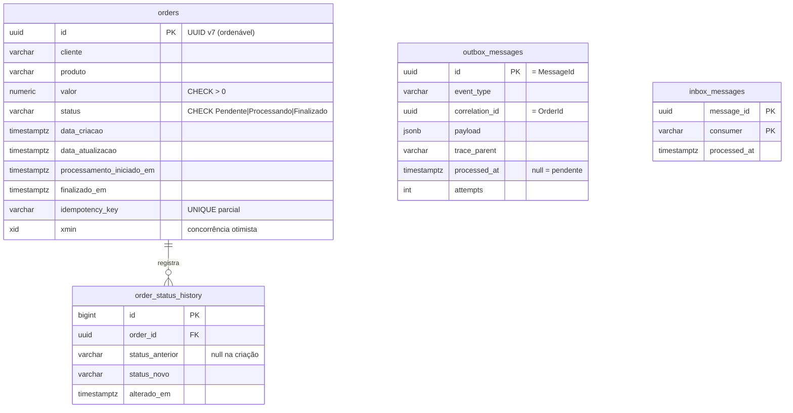

# Sistema de Gestão de Pedidos

[](https://github.com/ISMachado/tmb-order-management/actions/workflows/ci.yml)

Sistema de gestão de pedidos com **processamento assíncrono**: ao criar um pedido, a API grava no PostgreSQL e publica uma mensagem no RabbitMQ; um **worker** consome a mensagem, muda o status para **Processando** e, após 5 segundos, para **Finalizado**. O frontend mostra a mudança **em tempo real**. Há ainda um módulo de **IA** que responde perguntas em linguagem natural sobre os pedidos.

> Desafio técnico TMB — .NET + React/Next.js + PostgreSQL.

## Sumário

- [Rodando em 3 passos](#rodando-em-3-passos)
- [O que sobe e onde acessar](#o-que-sobe-e-onde-acessar)
- [Arquitetura](#arquitetura)
- [Decisões técnicas e justificativas](#decisões-técnicas-e-justificativas)
- [Confiabilidade da mensageria](#confiabilidade-da-mensageria)
- [API](#api)
- [Módulo de IA](#módulo-de-ia-pergunte-sobre-os-pedidos)
- [Variáveis de ambiente](#variáveis-de-ambiente)
- [Testes](#testes)
- [Como o projeto atende ao desafio](#como-o-projeto-atende-ao-desafio)
- [Limitações e próximos passos](#limitações-e-próximos-passos)

## Rodando em 3 passos

**Pré-requisito:** [Docker Desktop](https://www.docker.com/products/docker-desktop) aberto. Nada mais é necessário para rodar (.NET e Node só são necessários para rodar os testes fora do Docker).

```bash
git clone https://github.com/ISMachado/tmb-order-management.git && cd tmb-order-management   # 1. baixe o projeto
cp .env.example .env                           # 2. crie sua configuração (opcional: ajuste os valores)
docker compose up -d --build --wait            # 3. suba TUDO com um único comando
```

Atalho equivalente: `make up`. Na primeira vez leva alguns minutos (build das imagens); nas seguintes, cerca de 1 minuto.

Para desligar: `docker compose down` (mantém os dados) ou `make reset` (apaga os dados).

## O que sobe e onde acessar

| Serviço | URL | Para quê |
|---|---|---|
| **Frontend** (Next.js) | http://localhost:3000 | Criar, listar e acompanhar pedidos; página "Pergunte à IA" |
| **API** (.NET) + docs | http://localhost:5080/scalar | Documentação interativa (OpenAPI) com botão "Test Request" |
| Health da API | http://localhost:5080/health/ready | API + PostgreSQL + RabbitMQ |
| **pgAdmin** (admin do banco) | http://localhost:5050 | Já vem com o servidor "Orders" cadastrado; login = `PGADMIN_EMAIL` / `PGADMIN_PASSWORD` do `.env` |
| **RabbitMQ** (painel) | http://localhost:15672 | Filas, mensagens e DLQ; login = `RABBITMQ_USER` / `RABBITMQ_PASSWORD` |
| **Jaeger** (tracing) | http://localhost:16686 | Escolha o serviço `orders-api` e veja o caminho completo de um pedido |

Serviços do `docker-compose.yml`: `postgres`, `rabbitmq`, `migrator` (roda uma vez e sai), `api`, `worker`, `frontend`, `pgadmin`, `jaeger`.

## Arquitetura



### Fluxo de um pedido



### Máquina de estados



### Modelo de dados



As views `vw_pedidos` e `vw_historico_status` expõem os dados ao módulo de IA (que usa um usuário de banco somente leitura sem acesso às tabelas).

## Decisões técnicas e justificativas

| Camada | Escolha | Por quê |
|---|---|---|
| **Backend** | .NET 10 (LTS), ASP.NET Core **Minimal APIs** | Exigido (.NET). Minimal APIs deixam cada endpoint explícito e enxuto; camadas `Domain → Application → Infrastructure → Api/Worker` mantêm as regras de negócio no `Domain` (sem dependências) e separam casos de uso, infraestrutura e entrega. Por pragmatismo, a `Application` usa o EF Core através da abstração `IOrdersDbContext` (sem repositórios redundantes). |
| **Acesso a dados** | **EF Core + Npgsql**, colunas em `snake_case` | Migrations versionadas, transações simples (essenciais ao Outbox) e concorrência otimista via `xmin` do PostgreSQL, sem coluna extra. As consultas analíticas da IA usam Npgsql puro e parametrizado. |
| **Banco** | **PostgreSQL 17** | Exigido. Usado também por `FOR UPDATE SKIP LOCKED` (Outbox concorrente), `jsonb` (payload), índices parciais e `CHECK`. |
| **Mensageria** | **RabbitMQ 4** + `RabbitMQ.Client` 7 (sem framework por cima) | Roteamento por exchange/routing key, *quorum queues* com limite de entregas e DLQ nativos. Escrever Outbox, idempotência e retry explicitamente (em vez de esconder num framework) torna a confiabilidade auditável linha a linha. |
| **Tempo real** | **SignalR** com fallback de polling | Negocia sozinho WebSocket → SSE → Long Polling; se cair de vez, o frontend passa a consultar a cada 3 s. |
| **Frontend** | **Next.js 16** (App Router) + TypeScript, Tailwind CSS 4 | Exigido (React/Next.js). Tailwind permite UI responsiva e consistente sem biblioteca pesada. |
| **Estado do frontend** | TanStack Query, React Hook Form + Zod | Cache, revalidação e *optimistic patching* via eventos; validação do formulário espelhando as regras do backend. |
| **IA** | **Claude (Anthropic)** via `Microsoft.Extensions.AI` | *Tool calling* permite respostas com dados reais sem dar acesso livre ao banco. A abstração `IChatClient` torna trocar de provedor (OpenAI, Ollama…) uma mudança de configuração/DI. |
| **Observabilidade** | **OpenTelemetry → Jaeger**, Serilog | Um trace único atravessa HTTP → banco → broker → worker → tempo real. |
| **Testes** | xUnit, **Testcontainers**, **Verify**, Vitest | Integração com dependências reais e descartáveis; contratos "congelados" por snapshots. |
| **Infra** | **Docker Compose** | Um comando sobe tudo, com healthchecks e ordem de inicialização garantida. |
| **Admin do banco** | pgAdmin 4 pré-configurado | Abre já com o servidor cadastrado (sem configuração manual). |

## Confiabilidade da mensageria

O ponto central do desafio. Cada decisão abaixo tem um teste automatizado correspondente.

1. **Transactional Outbox** — a API *nunca* fala com o RabbitMQ dentro da requisição. Pedido, histórico e evento são gravados **na mesma transação**; um `BackgroundService` publica depois. Resultado: sem pedido sem mensagem, e o sistema continua aceitando pedidos mesmo com o RabbitMQ fora do ar (eles ficam `Pendente` e são processados quando o broker volta).
2. **Entrega *at-least-once* com *publisher confirms*** — uma linha do outbox só é marcada como publicada depois que o broker confirmou. Falhas fazem *retry* com backoff exponencial; `SKIP LOCKED` permite várias instâncias sem duplicar publicações em paralelo.
3. **Consumidor idempotente** (três camadas):
   - **Inbox** (`message_id` + consumidor): mensagem já vista é ignorada.
   - **Máquina de estados**: um pedido já `Finalizado` não é reprocessado, e `Pendente → Finalizado` direto é impossível.
   - **Concorrência otimista (`xmin`)**: dois workers no mesmo pedido → só um vence; o outro reavalia o estado.
4. **Retomada após queda** — se o worker cair durante os 5 s, a mensagem é reentregue; o pedido já está `Processando` e o worker **espera apenas o tempo que falta**, sem repetir a transição.
5. **Ack só após o commit** — se o worker morrer antes, a mensagem volta para a fila.
6. **DLQ** — erros transitórios têm retry com Polly (3 tentativas com backoff); se ainda assim falhar, a mensagem recebe `nack` sem requeue e vai para `orders.order-created.worker.dlq`, em vez de travar a fila. Além disso, a *quorum queue* tem `x-delivery-limit=5`, que manda para a DLQ mensagens reentregues repetidamente (ex.: worker que morre sempre no mesmo ponto). A DLQ é para inspeção e reprocessamento **manual** (painel do RabbitMQ); não há reprocessamento automático.
7. **Consumidor auto-recuperável** — além da recuperação automática de conexão do client, um *watchdog* recria o canal se ele for fechado pelo broker ou o consumer for cancelado, evitando que o worker pare de consumir silenciosamente.
8. **Mensagem conforme o desafio** — `CorrelationId = OrderId` e `EventType = OrderCreated` vão no corpo, nos *headers* e nas propriedades nativas do AMQP (`correlation_id`, `type`); mensagens são persistentes.
9. **Health checks** — `/health/live` (processo) e `/health/ready` (PostgreSQL + RabbitMQ) na API e no worker; todos os containers têm `healthcheck` no Compose.

## API

Documentação interativa em **http://localhost:5080/scalar**. JSON em `snake_case` (campos literais do desafio: `id`, `cliente`, `produto`, `valor`, `status`, `data_criacao`).

| Método | Rota | Descrição |
|---|---|---|
| `POST` | `/orders` | Cria um pedido (`201` + `Location`). Header opcional `Idempotency-Key` evita duplicidade em reenvios. |
| `GET` | `/orders` | Lista pedidos (mais novos primeiro). Filtros: `status`, `page`, `page_size`. |
| `GET` | `/orders/{id}` | Detalhes com **histórico de status**. `404` em *ProblemDetails* se não existir. |
| `GET` | `/health/live` · `/health/ready` | Saúde do processo · saúde de API + banco + mensageria. |
| `POST` | `/ai/ask` | Pergunta em linguagem natural (limite de 10/min por IP). |
| `GET` | `/ai/status` | Informa se a IA está habilitada. |
| `WS` | `/hubs/orders` | SignalR: evento `OrderStatusChanged`. |

```bash
curl -X POST http://localhost:5080/orders -H 'Content-Type: application/json' \
  -d '{"cliente":"Ana Souza","produto":"Notebook","valor":4599.90}'
```

Erros seguem RFC 9457 (*ProblemDetails*): `400` com `errors` por campo, `404`, `429` e `5xx` com `trace_id` (o mesmo id do trace no Jaeger).

## Módulo de IA: "Pergunte sobre os pedidos"

Acesse **http://localhost:3000/perguntas**. Exemplos: *"Quantos pedidos temos hoje?"*, *"Qual o tempo médio para aprovar os pedidos?"*, *"Quantos pedidos estão pendentes?"*, *"Qual o valor total de pedidos finalizados este mês?"*.

**Como funciona (segurança em camadas):**

1. A LLM **não escreve SQL livre por padrão**: recebe ferramentas tipadas (`contar_pedidos`, `somar_valor_pedidos`, `tempo_medio_processamento`, `listar_pedidos`, `resumo_por_status`, `ranking`) que executam consultas **parametrizadas**.
2. O *prompt* inclui a data/hora atual em `America/Sao_Paulo`, então "hoje" e "este mês" usam o fuso do usuário.
3. Existe uma ferramenta de reserva (`consulta_sql_somente_leitura`) protegida por: validador (um único `SELECT`, só as views permitidas) → usuário PostgreSQL `orders_readonly` sem acesso às tabelas → transação `READ ONLY` → `statement_timeout` → `LIMIT` forçado.
4. A resposta mostra **quais consultas foram executadas** (transparência).
5. Nomes de clientes/produtos são tratados como conteúdo **não confiável** no *prompt* (defesa contra *prompt injection*).

**Para ativar:** crie uma chave em https://console.anthropic.com → API Keys e coloque em `ANTHROPIC_API_KEY` no `.env`; depois `docker compose up -d api`. **Sem chave, o módulo se desativa sozinho** (a tela avisa) e o resto funciona normalmente.

**Trocar de provedor:** a LLM é usada só através de `Microsoft.Extensions.AI.IChatClient` (registro em `ServiceCollectionExtensions.AddAi`). Para OpenAI/Azure/Ollama basta registrar outro `IChatClient`.

`SEED_DEMO_DATA=true` (padrão no `.env.example`) cria 60 pedidos históricos na primeira subida, para a IA ter dados para analisar.

## Variáveis de ambiente

Todas em [`.env.example`](.env.example) (copie para `.env`; **o `.env` nunca vai para o Git**). Os `appsettings.json` não contêm segredos.

| Variável | Descrição |
|---|---|
| `POSTGRES_DB` / `POSTGRES_USER` / `POSTGRES_PASSWORD` | Banco principal |
| `ORDERS_READONLY_USER` / `ORDERS_READONLY_PASSWORD` | Usuário somente leitura da IA (criado pelo `migrator`) |
| `RABBITMQ_USER` / `RABBITMQ_PASSWORD` | Credenciais do RabbitMQ |
| `PGADMIN_EMAIL` / `PGADMIN_PASSWORD` | Login do pgAdmin |
| `ANTHROPIC_API_KEY` / `ANTHROPIC_MODEL` | Módulo de IA (opcional) |
| `SEED_DEMO_DATA` | `true` cria pedidos de demonstração |
| `PROCESSING_DELAY_SECONDS` | Tempo Processando → Finalizado (desafio: `5`) |
| `*_PORT` | Portas expostas no seu computador |

**Migrations automáticas:** o serviço `migrator` aplica as migrations do EF Core, provisiona o usuário somente leitura e (opcionalmente) o *seed*; `api` e `worker` só iniciam depois que ele termina com sucesso (`service_completed_successfully`). Isso evita corrida entre dois serviços migrando o mesmo banco.

## Testes

```bash
make test            # tudo (o Docker precisa estar aberto)
make test-backend    # dotnet test: unitários + integração + golden
make test-frontend   # lint + tipos + Vitest
```

| Tipo | Ferramenta | Cobertura |
|---|---|---|
| **Unitários** | xUnit | Máquina de estados, validadores, `SqlGuard` (SQL perigoso), resolução de períodos/fuso |
| **Integração** (bônus) | Testcontainers (PostgreSQL + RabbitMQ reais) | Fluxo completo POST → Outbox → RabbitMQ → Worker → `Finalizado`; mensagem duplicada; retomada após queda; consumidores concorrentes; headers `CorrelationId`/`EventType`; idempotency key; 400/404; health; módulo de IA contra o banco real com o usuário somente leitura |
| **Golden** (bônus) | Verify | Snapshots do contrato das mensagens, das respostas da API, do documento OpenAPI e das ferramentas/prompt da IA |
| **Frontend** | Vitest + Testing Library | Cache de eventos (idempotência e ordem), validação do formulário, componentes e fallback de tempo real |

A pipeline de CI (`.github/workflows/ci.yml`) roda tudo e ainda sobe o Compose para validar o fluxo de ponta a ponta.

Para aceitar uma mudança *intencional* de contrato nos golden tests: revise os arquivos `*.received.*` gerados em `backend/tests/Orders.GoldenTests/` e renomeie para `*.verified.*`.

## Como o projeto atende ao desafio

| Requisito | Onde |
|---|---|
| API REST (`POST/GET /orders`, `GET /orders/{id}`) | `Orders.Api/Endpoints/OrderEndpoints.cs` |
| Atributos `id, cliente, produto, valor, status, data_criacao` e 3 status | `Orders.Domain/Order.cs`, migration `InitialCreate` |
| Persistir e publicar mensagem ao criar | Outbox transacional (`OrderService`, `OutboxRelayService`) |
| Worker: Processando → 5 s → Finalizado | `Orders.Worker`, `OrderProcessor` |
| Sequência obrigatória de status | `OrderStatusTransitions` (domínio) + update atômico com `xmin`; `CHECK` valida os valores |
| Consumidor idempotente | Inbox + máquina de estados + `xmin` |
| `CorrelationId = OrderId`, `EventType = OrderCreated` | `RabbitMqPublisher` (headers, AMQP e corpo) |
| Health checks (API, banco, mensageria) | `/health/ready`; Compose |
| Frontend: tabela responsiva, formulário, detalhes, feedback de status | `frontend/src/app/pedidos`, `components/` |
| Subir tudo com um comando; env vars; migrations automáticas; healthchecks | `docker-compose.yml`, `.env.example`, `Orders.Migrator` |
| **Módulo de IA** | `Orders.Infrastructure/Ai`, `/perguntas` |
| Bônus: Outbox (+3), Histórico (+3), Tempo real com fallback (+3), Testes de integração isolados (+1), Tracing (+2), Golden Tests (+2), IA (+5) | Seções acima |
| README, justificativas, `.env.example`, diagramas | Este arquivo |

## Limitações e próximos passos

- **Sem autenticação/multi-tenant:** fora do escopo do desafio; o próximo passo natural seria OIDC e escopo por cliente (a IA e a lista precisariam filtrar por tenant).
- **Delay de 5 s em memória no worker:** simples e correto aqui, e a retomada após queda cobre o caso de falha. Para processamentos longos, o ideal seria um agendador durável (filas de atraso ou *scheduled messages*).
- **Evento `OrderCreated` não é empurrado ao navegador:** pedidos criados por *outras* sessões aparecem na lista no próximo evento de status (em ≤ 1 s) ou no polling de segurança (30 s). Publicar também `OrderCreated` no SignalR eliminaria esse intervalo.
- **Rate limit em memória** (por instância da API); com várias instâncias usar um limitador distribuído (Redis).
- **Limpeza do outbox/inbox:** linhas processadas acumulam; em produção, uma rotina de retenção.
- **Credenciais de demonstração:** as senhas do `.env.example` são só para uso local.
